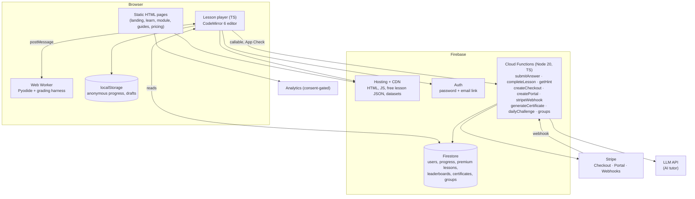
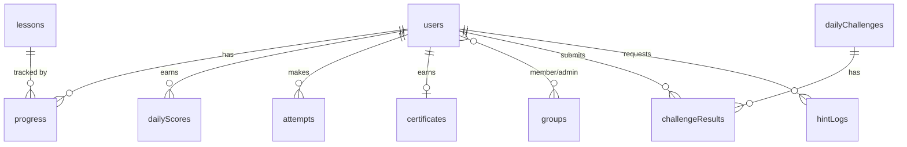

# Architecture — Python Exercises

## 1. Overview

Static multi-page site (Vite + TypeScript) on Firebase Hosting. Pages are pre-rendered HTML shells; client TypeScript fills in user-specific data from Firestore. Python runs in the learner's browser through Pyodide in a Web Worker. Anything that must be trusted — points, entitlements, certificates, AI calls, Stripe — goes through Cloud Functions.



## 2. Rendering model

- **Static (build time):** landing, module pages, guides, pricing, certificate explainer, legal. Generated by Vite from `src/pages/*` templates plus `content/` data, so they are fully crawlable.
- **Client-rendered:** dashboard data, lesson player state, leaderboards, account, admin, public certificate pages (fetched by ID).
- No SSR server. Routing is file-based (`/learn/`, `/practice/`) with query strings for the player.

## 3. Folder layout

```
.
├── CLAUDE.md
├── content/
│   ├── curriculum.json          # modules + lessons (source of truth for order and access)
│   ├── lesson.schema.json
│   ├── lessons/<lessonId>.json  # one file per lesson
│   ├── projects/<slug>/         # project.json + dataset files
│   └── guides/<slug>.md
├── src/
│   ├── pages/                   # one folder per route: index.html + main.ts
│   │   ├── home/  learn/  module/  practice/  daily/  projects/
│   │   ├── pricing/  certificate/  login/  register/  account/  admin/  guides/
│   ├── components/              # header, footer, modal, toast, progress-bar, leaderboard, lock-overlay
│   ├── player/                  # player state machine, question renderers, editor setup
│   ├── worker/
│   │   ├── python.worker.ts     # loads Pyodide, runs code, enforces limits
│   │   └── harness.py           # grading harness (see §7)
│   ├── lib/                     # firebase init, auth, firestore repos, analytics, entitlements
│   └── styles/                  # tokens.css, base.css, components.css
├── functions/
│   └── src/                     # one file per callable / trigger, shared validation in lib/
├── scripts/
│   ├── build-content.ts         # splits free/premium lessons, uploads premium to Firestore
│   ├── validate-content.ts      # schema + run solutions through harness (uses Pyodide in Node)
│   └── generate-sitemap.ts
├── firestore.rules
├── firestore.indexes.json
├── firebase.json
├── tests/                       # vitest, playwright, rules tests
└── docs/
```

## 4. Data model (Firestore)



| Collection / path | Key fields | Written by |
|---|---|---|
| `users/{uid}` | `firstName`, `username`, `usernameLower`, `createdAt`, `tz`, `entitlement` (`free`/`premium`), `entitlementSource` (`stripe`/`lifetime`/`group`/`manual`), `stripeCustomerId`, `premiumUntil`, `groupIds[]`, `shareBonusClaimed` | Client (profile fields only) + Functions (entitlement, stripe fields) |
| `usernames/{usernameLower}` | `uid` | Function `claimUsername` (uniqueness) |
| `users/{uid}/progress/{lessonId}` | `completed`, `bestAccuracy`, `lastPractisedAt`, `questionState{qId: {tries, correct, viewedSolution}}` | Function `completeLesson`; client may write `questionState` drafts |
| `users/{uid}/attempts/{autoId}` | `lessonId`, `questionId`, `correct`, `try`, `points`, `at` | Function `submitAnswer` |
| `dailyScores/{yyyy-mm-dd}/users/{uid}` | `username`, `points`, `streak` | Function `submitAnswer` / `completeLesson` |
| `lessonContent/{lessonId}` | full lesson JSON for **premium** lessons | `scripts/build-content.ts` (admin SDK) |
| `dailyChallenges/{yyyy-mm-dd}` | `questionRefs[]` (lessonId + questionId) | Scheduled function `buildDailyChallenge` |
| `dailyChallenges/{date}/results/{uid}` | `accuracy`, `seconds`, `username` | Function `submitChallenge` |
| `certificates/{credentialId}` | `uid`, `name`, `issuedAt`, `modules[]`, `public` | Function `generateCertificate` |
| `groups/{groupId}` | `name`, `adminUids[]`, `inviteCode`, `premiumSeats`, `memberCount` | Functions |
| `groups/{groupId}/members/{uid}` | `joinedAt`, `username` | Function `joinGroup` |
| `hintLogs/{autoId}` | `uid`, `lessonId`, `questionId`, `helpful` | Function `getHint`; client sets `helpful` |
| `feedback/{autoId}` | `uid`, `lessonId`, `rating`, `text` | Client (create only) |

**Content delivery:**
- Free lessons (`free: true` in curriculum) are emitted at build to `/data/lessons/<id>.json` on Hosting — public, cacheable.
- Premium lessons are uploaded to `lessonContent/{id}` and readable only by premium users (rules below). The client fetches the static file first and falls back to Firestore.
- `curriculum.json` (titles, order, flags — no questions) is public.

## 5. Security

### 5.1 Firestore rules (outline — implement fully with tests)

```
rules_version = '2';
service cloud.firestore {
  match /databases/{db}/documents {
    function signedIn() { return request.auth != null; }
    function isSelf(uid) { return signedIn() && request.auth.uid == uid; }
    function user() { return get(/databases/$(db)/documents/users/$(request.auth.uid)).data; }
    function isPremium() {
      return signedIn() && user().entitlement == 'premium'
        && (user().premiumUntil == null || user().premiumUntil > request.time);
    }

    match /users/{uid} {
      allow read: if isSelf(uid);
      allow create: if isSelf(uid) && request.resource.data.keys().hasOnly(['firstName','tz','createdAt']);
      allow update: if isSelf(uid) && request.resource.data.diff(resource.data).affectedKeys().hasOnly(['firstName','tz']);
      match /progress/{lessonId} {
        allow read: if isSelf(uid);
        allow write: if isSelf(uid) && request.resource.data.diff(resource.data).affectedKeys().hasOnly(['questionState']);
      }
      match /attempts/{id} { allow read: if isSelf(uid); allow write: if false; }
    }
    match /lessonContent/{lessonId} { allow read: if isPremium(); allow write: if false; }
    match /dailyScores/{day}/users/{uid} { allow read: if true; allow write: if false; }
    match /dailyChallenges/{day} { allow read: if true; allow write: if false;
      match /results/{uid} { allow read: if true; allow write: if false; } }
    match /certificates/{id} { allow read: if resource.data.public == true || isSelf(resource.data.uid); allow write: if false; }
    match /groups/{gid} { allow read: if signedIn() && request.auth.uid in resource.data.adminUids; allow write: if false;
      match /members/{uid} { allow read: if isSelf(uid) || (signedIn() && request.auth.uid in get(/databases/$(db)/documents/groups/$(gid)).data.adminUids); allow write: if false; } }
    match /feedback/{id} { allow create: if signedIn(); allow read, update, delete: if false; }
    match /hintLogs/{id} { allow update: if signedIn() && resource.data.uid == request.auth.uid
                             && request.resource.data.diff(resource.data).affectedKeys().hasOnly(['helpful']); }
    match /usernames/{u} { allow read: if true; allow write: if false; }
  }
}
```

### 5.2 Other controls
- **App Check** (reCAPTCHA Enterprise) enforced on all callable functions.
- Restrict the Firebase web API key to production and preview domains.
- Stripe webhook verifies signatures; secret in Functions config.
- LLM key only in Functions secrets.
- Rate limits in functions (per uid per minute): `submitAnswer` 60, `getHint` per §SPEC 5.6, `completeLesson` 20.
- CSP header in `firebase.json`: scripts from self + Pyodide CDN (or self-host Pyodide under `/pyodide/`, preferred), Stripe, analytics.

### 5.3 Grading trust model
Code questions are graded in the browser, so a determined user can fake a pass. Mitigations: per-question point caps, one award per question per day, rate limits, server re-check of non-code answers (`multiple_choice`, `predict_output`, exact `fill_blank`) against answer hashes stored server-side, and leaderboards that are fun rather than prize-bearing. Optional later: run Pyodide in a Function to re-grade code answers for leaderboard-eligible submissions.

## 6. Cloud Functions

| Function | Type | Input → Output | Notes |
|---|---|---|---|
| `claimUsername` | callable | `{username}` → `{ok}` | Transaction on `usernames/` |
| `submitAnswer` | callable | `{lessonId, questionId, try, correct, answerHash?}` → `{points, dailyPoints}` | Validates entitlement + unlock, recomputes points, writes attempt + dailyScores |
| `completeLesson` | callable | `{lessonId, accuracy}` → `{streak, nextLessonId}` | Updates progress, streak |
| `mergeAnonymousProgress` | callable | `{progress[]}` → `{merged}` | Only free lessons, once per account |
| `getHint` | callable | `{lessonId, questionId, code, failMessage}` → `{hint, hintId}` | Quota, prompt built server-side from lesson data; never returns the solution |
| `createCheckoutSession` | callable | `{plan}` → `{url}` | Price ids from config; `allow_promotion_codes: true` |
| `createPortalSession` | callable | `{}` → `{url}` | |
| `stripeWebhook` | https | Stripe events → 200 | Sets `entitlement`, `premiumUntil`, `entitlementSource` |
| `generateCertificate` | callable | `{name}` → `{credentialId}` | Checks completion of modules 1–12; name immutable |
| `buildDailyChallenge` | scheduled 00:00 UTC | → writes `dailyChallenges/{date}` | Seeded by date |
| `submitChallenge` | callable | `{date, answers}` → `{accuracy, rank}` | One scored attempt per day |
| `createGroup` / `joinGroup` / `removeMember` / `exportGroupCsv` | callable | | Admin checks |
| `onUserDelete` | auth trigger | | Cleans user data, anonymises scores |

## 7. Grading engine

`src/worker/python.worker.ts` owns one Pyodide instance. Messages:

```ts
// main → worker
{ type: 'init' }
{ type: 'run',   id, code }                                   // Run button
{ type: 'grade', id, code, tests: Test[], setupCode?: string } // Check button
// worker → main
{ type: 'ready' }
{ type: 'result', id, stdout, stderr, error?: {type, message, line} }
{ type: 'graded', id, passed: boolean, results: {name, passed, message}[], stdout, error? }
```

Timeouts: main thread starts a 5 s timer per request; on expiry it `terminate()`s the worker, spins a new one, and reports "Your code took too long — check for an infinite loop." Use `SharedArrayBuffer` interrupts only if cross-origin isolation headers are enabled; the terminate approach works everywhere.

`src/worker/harness.py` (reference implementation shipped in this pack as `content/tools/harness.py`):
1. Runs optional `setupCode` in a fresh namespace dict.
2. Executes the learner's code in that namespace with stdout captured. Syntax/runtime errors → fail with the traceback's last line and line number.
3. Puts captured output into the namespace as `__output__` (string).
4. Runs each test's `code` in the same namespace. A test passes if it raises nothing. On `AssertionError`, the failure message is the assertion message if present, else the test's `message`.
5. Returns per-test results; question passes when all tests pass.

## 8. Build and deploy

- `npm run build` → `scripts/validate-content.ts` (fails the build on invalid lessons) → Vite build → `scripts/build-content.ts --emit-free` → `scripts/generate-sitemap.ts`.
- `npm run deploy` → `firebase deploy --only hosting,functions,firestore:rules,firestore:indexes` and `scripts/build-content.ts --upload-premium`.
- Environments: `dev` (emulators), `staging` (separate Firebase project, Stripe test mode), `prod`.
- Caching (`firebase.json`): hashed assets `max-age=31536000, immutable`; HTML `no-cache`; `/data/lessons/*.json` `max-age=300`; Pyodide files `max-age=31536000`.
