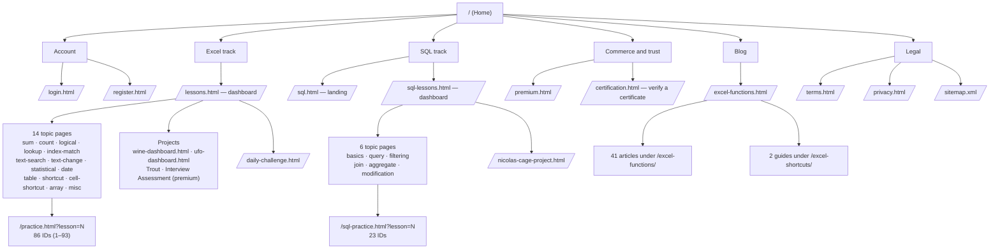
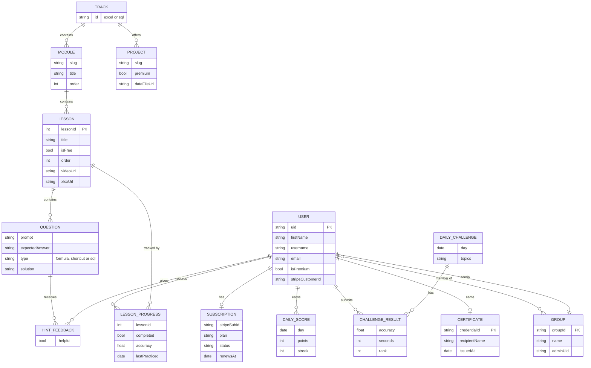
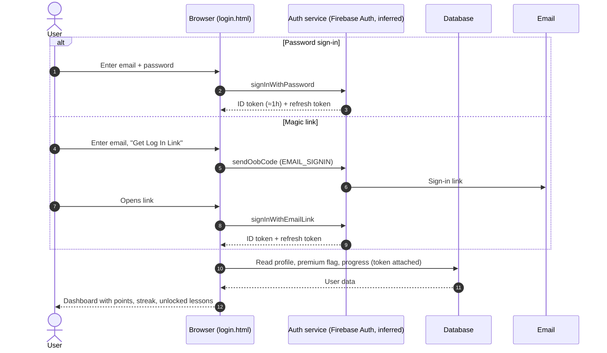
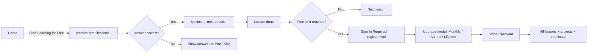
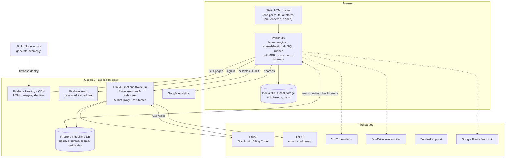

# ExcelExercises.com — Technical Analysis Report

*Prepared 28 October 2026 · Passive analysis (no browser session available)*

> **How to read this report.** Every finding is tagged:
> - **[Observed]** — seen directly in the site's served HTML, sitemap, legal pages or store listing.
> - **[Inferred]** — a strong conclusion from observed evidence, not directly seen.
> - **[Needs browser]** — can only be confirmed by loading the site in a real browser (network panel, cookies, loaded scripts).
>
> The shell in this workspace is blocked from reaching the site (HTTP 403 at the proxy) and neither Chrome nor the desktop app's browser was reachable from this chat. So the site was read through a fetcher that returns rendered page text, not raw HTML, headers, cookies or network traffic. Sections 3, 6 and 7 are therefore partly inferred, and each ends with the exact checks to run when a browser is available. No forms were submitted, no account was created, and nothing intrusive was attempted.

---

## 1. Executive Summary

ExcelExercises.com is a gamified, freemium e-learning web app that teaches Microsoft Excel (and, since early 2026, SQL) through hands-on practice in an in-browser spreadsheet simulator. It is operated by **App Factory, LLC** and founded by **Jake (Jacob) Shimota**. It claims 250,000+ registered users and 50+ partner organizations. **[Observed]**

**How it is built, in one paragraph:** a set of **hand-authored static HTML pages** served from **Firebase Hosting**, each made interactive by **client-side JavaScript** that loads lesson content, progress, points and leaderboards from a backend after page load. That backend is most likely **Firebase (Auth + a Firestore/Realtime Database + Cloud Functions)**. **Stripe** handles subscriptions through Checkout and its Customer Portal. A **Node.js build script** generates the sitemap. There is no evidence of React, Angular, Vue, Next.js or any CMS. **[Observed + Inferred]**

**Business model:** a few lessons are free with no sign-up. After that a sign-in wall and then a paywall apply: Monthly $19.99, Annual $59.99, Lifetime $199. Premium adds all lessons, downloadable project files and a verifiable certificate. Teachers can get free access for students, and there is a group-admin role for organizations. **[Observed]**

**Key gaps:** exact client libraries (spreadsheet grid, SQL engine, AI vendor), API endpoints, cookies and bundle sizes need a browser session to confirm.

---

## 2. Complete Sitemap

### 2.1 Navigation

| Location | Items **[Observed]** |
|---|---|
| Header (all pages) | Logo → `/`, Log In, Sign Up |
| Breadcrumbs (lesson pages) | Dashboard → Topic page → Lesson |
| Footer | Email, Facebook, LinkedIn, YouTube, X · Learn SQL · Excel Certification · Blog · Terms · Privacy Policy · Sitemap |
| Dashboard links | Daily challenge, Next Recommended Lesson, Give Feedback (Google Form), log in / create an account |
| Buttons with no URL (JS-driven) | Admin Portal, Upgrade to Premium, Manage Subscription, Start Project, Generate Certificate, Reset Progress, Share |

### 2.2 Page inventory

### 2.3 Full URL list

**Core and account (11)** **[Observed]**
`/` · `/lessons.html` · `/sql.html` · `/sql-lessons.html` · `/premium.html` · `/certification.html` · `/daily-challenge.html` · `/login.html` · `/register.html` · `/terms.html` · `/privacy.html` · plus `/sitemap.xml`

**Excel topic pages (14)**

| Page | Title | Topics |
|---|---|---|
| `/sum-lessons.html` | Practice SUM Functions | SUM, SUMIF, SUMIFS |
| `/count-lessons.html` | Practice COUNT Functions | COUNT, COUNTIF, COUNTIFS |
| `/logical-lessons.html` | Logical Functions | TRUE/FALSE, AND/OR/XOR, IS, IF, IFS, SWITCH |
| `/lookup-lessons.html` | Practice Lookup Functions | VLOOKUP, HLOOKUP, XLOOKUP |
| `/index-match-lessons.html` | Index Match Lookup | INDEX, MATCH, INDEX+MATCH |
| `/text-search-lessons.html` | Text Search Functions | LEN, LEFT, RIGHT, MID, FIND, SEARCH, wildcards |
| `/text-change-lessons.html` | Text Manipulation | CONCAT, TEXTJOIN, UPPER/LOWER/PROPER, SUBSTITUTE |
| `/statistical-lessons.html` | Statistical Functions | AVERAGE, MIN/MAX, LARGE/SMALL, FLOOR/CEILING, MEDIAN, MODE |
| `/date-lessons.html` | Practice DATE Functions | DATE, TODAY, DATEDIF, DAYS |
| `/table-lessons.html` | Practice Pivot Tables | Filters, Pivot Tables |
| `/shortcut-lessons.html` | Practice Keyboard Shortcuts | Intro shortcuts |
| `/cell-shortcut-lessons.html` | Cell Selection Shortcuts | Selection shortcuts |
| `/array-lessons.html` | Array Formulas | UNIQUE, FILTER, SORT |
| `/misc-lessons.html` | Practice Excel Skills | Conditional formatting, worksheets |

**SQL topic pages (6)** — the lesson counts here are in the served HTML and add up to 12:

| Page | Topics | Lessons |
|---|---|---|
| `/sql-basics-lessons.html` | What is SQL? | 1 |
| `/sql-query-lessons.html` | SELECT, SELECT DISTINCT, ORDER BY | 3 |
| `/sql-filtering-lessons.html` | WHERE, AND, OR, NOT | 2 |
| `/sql-join-lessons.html` | INNER, LEFT, RIGHT, FULL | 2 |
| `/sql-aggregate-lessons.html` | MIN, MAX, COUNT, SUM | 2 |
| `/sql-modification-lessons.html` | INSERT, UPDATE, DELETE | 2 |

**Lesson player routes**
- `/practice.html?lesson=` 1, 2, 3, 5–11, 13–15, 17–19, 21, 23–35, 37–43, 45–93 → **86 Excel lessons**. Gaps (4, 12, 16, 20, 22, 36, 44) look like retired lessons.
- `/sql-practice.html?lesson=` 1–23 → **23 SQL lesson IDs**. This is more than the 12 counted on topic pages; the extra IDs may be steps, drafts, or the shared template.
- Optional `&intro=1` parameter shows the lesson's intro screen (used by blog links).

**Projects (5)** — `/wine-dashboard.html`, `/ufo-dashboard.html`, `/nicolas-cage-project.html`, plus Trout Dashboard and Interview Assessment (premium; served through dashboard modals, URLs not exposed).

**Blog (43)** — 41 pages under `/excel-functions/` (absolute-reference, average, bold-italics-underline, change-case-upper-lower-proper, concat, count, countif, countifs, create-drop-down-list, date, extract-first-word, extract-last-word, find-function, format-painter-copy-format, hlookup, if, ifs, indeed-excel-assessment-practice, index-function, large-small, left-function, len-function, len-left-right-mid, logical-functions, logical-operators, match, mid-function, min-max, mo-200-excel-exam-practice, mo-201-excel-exam-practice, substitute, sum, sumif, sumifs, switch, textafter, textbefore, textjoin, today-function, vlookup, wildcard-characters, xlookup) and 2 under `/excel-shortcuts/` (ribbon-shortcuts, shift-control).

**Hidden or unlisted pages found:** `/premium.html`, `/daily-challenge.html`, `/register.html`, `/wine-dashboard.html`, `/ufo-dashboard.html` and `/nicolas-cage-project.html` are reachable but **not in the sitemap**. An **Admin Portal** exists (button on the dashboard for group admins) but its URL is not exposed to logged-out visitors. **[Observed]**

**Other surfaces:** an iOS app, "Excel Exercises - Learn Excel" (App Store id 1526711088, App Factory LLC, free, offline reference and flashcards) **[Observed]**, and a YouTube channel with lesson videos.

---

## 3. Technology Stack

| Layer | Technology | Status | Evidence |
|---|---|---|---|
| Rendering | Static `.html` files + vanilla JavaScript (no SPA framework) | **[Observed]** | Flat `.html` routes; query-string routing (`?lesson=N`); raw HTML of every lesson is identical with "Loading…" placeholders; all modals for every state are present in the HTML and toggled by script |
| Frontend framework | None detected (not React/Vue/Angular/Next/Nuxt/Svelte) | **[Inferred]** | No framework route patterns, no `/_next/` or `/_nuxt/` paths, no client-router URLs; hand-built multi-page structure. Confirm by inspecting loaded scripts |
| CSS / UI | Custom CSS, responsive (viewport meta); framework unknown | **[Needs browser]** | Class names are not visible in the fetched text |
| Hosting / CDN | Google **Firebase Hosting** (Google's global CDN) | **[Observed]** | Privacy policy names Firebase as the hosting provider |
| Backend | **Firebase** (Auth, Firestore or Realtime Database, Cloud Functions) | **[Inferred]** | Firebase hosting; passwordless email-link sign-in is a built-in Firebase Auth feature; real-time daily leaderboards; no server-rendered personal data |
| Backend language | JavaScript / Node.js (Cloud Functions runtime and build scripts) | **[Inferred]** | `scripts/generate-sitemap.js` comment in the sitemap **[Observed]**; Firebase Functions run on Node.js |
| CMS | None | **[Inferred]** | No WordPress, Webflow, Ghost or similar markers; articles are static HTML files with manual `lastmod` dates |
| Payments | **Stripe** (Checkout + Customer Billing Portal, promotion codes) | **[Observed]** | Terms name the "Stripe Payments & Billing Portal"; "Manage Subscription" button; "promotion code" option at checkout |
| Analytics | **Google Analytics** | **[Observed]** | Named in privacy policy |
| Tag manager | Google Tag Manager | **Unverified** | Reported once in an earlier fetch but not reproducible on re-check; confirm in browser |
| Crash reporting | Firebase **Crashlytics** | **[Observed]** | Privacy policy (most likely for the iOS app) |
| Support | **Zendesk** | **[Observed]** | Privacy policy |
| AI | "✨ Formula Assistant" — LLM-generated hints with 👍/👎 feedback | **[Observed]** feature; vendor **[Needs browser]** | Lesson player UI |
| Spreadsheet simulator | In-browser spreadsheet grid; library unknown | **[Needs browser]** | "Loading spreadsheet…" placeholder and .xlsx download fallback |
| SQL simulator | In-browser query runner against a sample database; engine unknown (sql.js/SQLite-WASM is the usual choice) | **[Needs browser]** | SQL page says queries run against sample databases in the browser |
| Forms | Google Forms (feedback) | **[Observed]** | Dashboard link |
| Media | PNG/WebP images, YouTube videos, OneDrive-hosted solution files | **[Observed]** | Asset URLs and project pages |
| SEO | Canonical tags, Open Graph, Twitter cards, Bing site verification, generated XML sitemap with priorities | **[Observed]** | Home page head |
| Social | LinkedIn, Facebook and X share intents | **[Observed]** | Share buttons |

---

## 4. API Inventory

No request was captured (no browser). Below is the expected inventory, derived from the features the UI exposes and from how Firebase apps normally talk to their backend. Each row should be confirmed in the browser's network panel.

| # | Purpose (UI trigger) | Expected transport | Method / shape | Status |
|---|---|---|---|---|
| 1 | Sign in with password | Firebase Auth REST (`identitytoolkit.googleapis.com/v1/accounts:signInWithPassword`) | POST `{email, password, returnSecureToken}` → `{idToken, refreshToken, localId, expiresIn}` | **[Inferred]** |
| 2 | "Get Log In Link" | Firebase Auth `accounts:sendOobCode` (`requestType: EMAIL_SIGNIN`) | POST `{email, continueUrl}` | **[Inferred]** |
| 3 | Complete email-link sign-in | `accounts:signInWithEmailLink` | POST `{email, oobCode}` | **[Inferred]** |
| 4 | Register ("Create Profile") | `accounts:signUp`, then a write of a user profile (first name, username) | POST + database write | **[Inferred]** |
| 5 | Reset password | `accounts:sendOobCode` (`PASSWORD_RESET`) | POST `{email}` | **[Inferred]** |
| 6 | Keep session alive | `securetoken.googleapis.com/v1/token` | POST `{grant_type: refresh_token}` | **[Inferred]** |
| 7 | Load lesson content | Database read by lesson ID, or a static JSON/JS file per lesson | GET | **[Needs browser]** |
| 8 | Save answer / progress | Database write: completion, accuracy, last-practiced date | Write / PATCH | **[Inferred]** |
| 9 | Points and streak updates | Database write or Cloud Function | Write | **[Inferred]** |
| 10 | Today's high scores / streaks | Real-time listener (Firestore `Listen` channel or Realtime DB WebSocket) | Long-poll or WebSocket | **[Inferred]** |
| 11 | AI hint | Cloud Function proxy → LLM API (keeps the vendor key server-side) | POST `{lessonId, question, userAnswer}` → `{hint}` | **[Inferred]** |
| 12 | Hint feedback 👍/👎 | Database write | Write | **[Inferred]** |
| 13 | Upgrade | Cloud Function creates a Stripe Checkout Session → redirect to `checkout.stripe.com` | POST → 303 | **[Inferred]** |
| 14 | Manage Subscription | Cloud Function creates a Stripe Billing Portal session → redirect to `billing.stripe.com` | POST → 303 | **[Inferred]** |
| 15 | Subscription status | Stripe webhook → Cloud Function → user record flag | Server-to-server | **[Inferred]** |
| 16 | Generate certificate | Cloud Function or client write: name + credential ID + issue date | POST | **[Inferred]** |
| 17 | Verify certificate | Public lookup by credential ID on `/certification.html` | GET / read | **[Inferred]** |
| 18 | Daily challenge result | Write `{accuracy, time}` → read global rank | Write + read | **[Inferred]** |
| 19 | Reset progress | Delete of the user's progress records | Delete | **[Inferred]** |
| 20 | Admin Portal | Group-scoped reads of members' progress | Read | **[Inferred]** |
| 21 | Analytics | `google-analytics.com/g/collect` | GET/POST beacons | **[Inferred]** |

**GraphQL:** none expected. **WebSockets:** likely only the Firebase real-time channel for leaderboards.

**Browser check:** DevTools → Network, filter `googleapis|firebase|stripe|function|collect`, and record method, URL, payload and response for each row above while signed out, signed in (free) and on a lesson.

---

## 5. Database / Data Model Assumptions

**Domain logic inferred from the UI** **[Inferred from observed behaviour]**
- **Free tier:** first lesson(s) open with no account; a "Free Lesson Limit" then requires sign-in and then upgrade.
- **Sequential unlock:** each topic requires lesson 1 to be completed first.
- **Spaced repetition:** a lesson's dashboard state is *Low Accuracy*, *Needs Practice* (last practiced ≥14 days ago) or *Good* (<14 days). So `accuracy` and `lastPracticed` are stored per user per lesson.
- **Gamification:** points per correct answer, reset daily ("Today's High Scores"); a streak counts consecutive days with a completed lesson; 500 bonus points for a LinkedIn share; leaderboards show only signed-in users.
- **Certificate:** issued once all lessons are complete; the recipient name is immutable once generated (entered twice to confirm); it has a credential ID and is publicly verifiable.
- **Groups:** an admin can view group members (teacher/organization use); teachers can request free student access by email.
- **Projects:** UFO, Wine and Interview are premium; Trout's modal shows no premium notice.
- **Reset progress** deletes all completion records.

---

## 6. Authentication Flow

**Observed options:** email + password; passwordless email link ("Get Log In Link"); password reset. No Google, Microsoft or SSO buttons. Registration asks for first name, username, email (twice) and password. **[Observed]**

**Security observations**
- **Session model:** with Firebase Auth, tokens are kept in the browser's IndexedDB, not cookies; the privacy policy also mentions "session ID cookies." **[Inferred / Observed]** Check: DevTools → Application → Cookies and IndexedDB `firebaseLocalStorageDb`.
- **Public Firebase config:** a Firebase web app embeds its API key and project ID in client JavaScript. That is normal and not a secret, but it makes **database security rules the real access control**. Rules must stop a user from writing their own `isPremium` flag, points or leaderboard scores. **[Recommendation]**
- **Client-side gating risk:** because all locked/unlocked states ship in one HTML page, the paywall must be enforced by the data layer (lesson content only readable by premium users), not by hiding elements. **[Needs browser]** to see whether premium lesson data is fetchable while signed out.
- **Leaderboard integrity:** points written directly from the client can be spoofed; scoring should be validated server-side.
- **Emails and IDs exposed:** a support address (jake@excelexercises.com) and the Google Form ID are public; neither is a secret. No secrets were seen in the served pages.
- **Privacy policy gaps:** it still cites the BBB EU Privacy Shield (invalidated in 2020) and does not name Stripe as the payment processor, which the Terms do.

---

## 7. User Flows

### 7.1 Anonymous visitor → paying learner

### 7.2 Workflows, step by step

**Practice a lesson** **[Observed UI]**
1. Open a lesson from the dashboard, a topic page or a blog "Continue to … practice" link.
2. Optional: Watch Video. Shortcut lessons show a Mac warning, and on phones a "Mobile Device Detected" notice, each with "Skip section."
3. Read the prompt and type the formula in the spreadsheet (or press the shortcut).
4. Press Enter or **Check Answer** → "Correct! +N pts" or "Incorrect."
5. If incorrect: **Show Correct Answer**, the **Solution** panel, or the **Formula Assistant** hint, then rate the hint 👍/👎.
6. **Continue →** to the next question, or **Previous** / **Skip Question**.
7. If the grid fails to load, download the lesson's .xlsx file.
8. **Flashcard Mode** serves random questions without stopping.

**Dashboard**
1. View lessons completed, accuracy states and Next Recommended Lesson.
2. See today's high scores, streaks and the 7-day daily-challenge trend.
3. Open a project modal → Start Project (premium gate).
4. Reset Progress (confirmation modal).
5. Generate Certificate (enter name twice, permanent).
6. Admins: Go to Admin Portal.

**Daily challenge:** Start Challenge → answer → see Accuracy, Time and Global Rank → share → "come back tomorrow."

**Certificate verification:** on `/certification.html`, search a credential → shows recipient, credential ID and issue date.

**Subscription management:** Profile → Manage Subscription → Stripe portal (cancel, or cancel at period end). Refunds by email.

**Search:** there is no site-wide search. The only search box is certificate verification.

**Not exercised** (needs credentials or would submit forms): sign-up, login, checkout, certificate generation, admin portal.

---

## 8. Architecture Diagram

**Rendering model:** **CSR on static shells.** HTML is pre-written (not server-rendered per request, not ISR); every dynamic value — lesson content, progress, points — is filled in by client JavaScript. The SEO pages (home, blog articles, project guides) are fully static, so they are crawlable. **[Observed + Inferred]**

**Route structure:** flat file-based routes (`/name.html`), query-string parameters for the lesson player (`?lesson=N&intro=1`), and two path prefixes for content (`/excel-functions/`, `/excel-shortcuts/`). **[Observed]**

**State management:** no framework store. State most likely lives in module variables, the auth SDK's persisted session, the database's local cache, and a few localStorage flags. The SQL player is a fork of the Excel player — its HTML still contains the Excel breadcrumbs, the "1. Intro to Functions" heading and the 69-lesson Excel FAQ catalog. **[Observed]** for the fork; **[Needs browser]** for storage.

**Caching:** Firebase Hosting caches static files at the CDN edge; `.html` files are typically short-cache. The SDK caches database reads locally. Exact `Cache-Control` headers **[Needs browser]**.

---

## 9. Third-party Integrations

| Service | Role | Status |
|---|---|---|
| Google Firebase | Hosting, (likely) auth, database, functions, Crashlytics | Observed / Inferred |
| Stripe | Subscriptions, billing portal, promo codes | Observed |
| Google Analytics | Usage analytics | Observed |
| Google Tag Manager | Tag container | Unverified |
| Zendesk | Customer support | Observed |
| Google Forms | Feedback survey | Observed |
| YouTube | Lesson and project videos | Observed |
| Microsoft OneDrive | Read-only completed project files | Observed |
| LinkedIn / Facebook / X | Share intents, certificate to LinkedIn | Observed |
| LLM provider | Formula Assistant hints | Observed feature, vendor unknown |
| Bing Webmaster Tools | Site verification meta tag | Observed |
| Apple App Store | iOS companion app | Observed |

---

## 10. Performance Notes

**Observed from served pages**
- Images use **WebP** for partner logos and loading animations, with PNG for logos and screenshots.
- Pages are plain HTML, so first paint does not wait for a framework to boot.
- Lesson pages show a "Loading…" state and a "Loading spreadsheet…" state, with an .xlsx download offered if the grid does not appear "within a few seconds" — a sign that the grid script is heavy or sometimes slow.
- Every lesson page ships the full markup for every state: the completion screen, mobile notice, all upgrade copy, the FAQ and a 69-item lesson catalog. That inflates each HTML document.

**Inferred**
- Leaderboard listeners keep a connection open on lesson pages.
- Each `practice.html` view re-downloads the same template; there is no client router, so navigating between lessons reloads the page.

**Browser checks to run:** Lighthouse (mobile) on `/`, `/lessons.html` and `/practice.html?lesson=1`; Network panel → total JS bytes, number of scripts, whether `defer`/`async` and `loading="lazy"` are used, image dimensions vs display size, cache headers.

---

## 11. Recommendations

**Security and integrity**
1. Audit Firebase security rules: users must not be able to set premium status, points, streaks, ranks or certificates on their own records; route scoring and certificate issue through Cloud Functions.
2. Make sure premium lesson content is only readable by premium users at the data layer, not just hidden in the UI.
3. Restrict the Firebase web API key to the site's domains, and add App Check to cut abuse of the AI hint endpoint.
4. Rate-limit the AI hint and magic-link endpoints.
5. Update the privacy policy: remove the obsolete EU Privacy Shield reference and name Stripe as the processor.

**Performance**
6. Stop embedding every state's markup in each lesson page; load upgrade copy, FAQ and catalog on demand.
7. Lazy-load the spreadsheet grid and SQL engine, and preload the lesson's data so the "Loading spreadsheet…" fallback is rarely needed.
8. Serve all screenshots as WebP/AVIF with explicit width and height.

**Product and SEO**
9. Add the unlisted public pages (premium, daily challenge, project guides) to the sitemap.
10. Fix the DATE article link, which points to the SUMIFS lesson (ID 30).
11. Clean up the SQL player template: it still carries Excel breadcrumbs, headings and the Excel lesson catalog.
12. Reconcile lesson counts: topic pages show a fixed "0/4", the SQL pages list 12 lessons against 23 SQL IDs in the sitemap, and the upgrade copy says "60+" against a 69-item catalog.
13. Add site-wide search across lessons and articles.

---

## 12. To finish with a browser

When Chrome with the Claude extension is available, these steps close every **[Needs browser]** item without touching any account:

1. Load `/`, `/lessons.html`, `/practice.html?lesson=1`, `/sql-practice.html?lesson=1` signed out.
2. Record all network requests (method, host, path, payload shape, response shape).
3. List every loaded script and stylesheet (identify the spreadsheet library, SQL engine, CSS framework, GTM/GA IDs).
4. Inspect cookies, localStorage and IndexedDB.
5. Read response headers (`server`, `cache-control`, `x-*`, CSP).
6. Run Lighthouse for load metrics and bundle sizes.
7. Click every non-destructive control; avoid Reset Progress, checkout and form submits.

---

### Sources
- Site pages: [Home](https://excelexercises.com/), [Sitemap](https://excelexercises.com/sitemap.xml), [Dashboard](https://excelexercises.com/lessons.html), [SQL](https://excelexercises.com/sql.html), [SQL dashboard](https://excelexercises.com/sql-lessons.html), [Premium](https://excelexercises.com/premium.html), [Certification](https://excelexercises.com/certification.html), [Daily challenge](https://excelexercises.com/daily-challenge.html), [Login](https://excelexercises.com/login.html), [Register](https://excelexercises.com/register.html), [Terms](https://excelexercises.com/terms.html), [Privacy](https://excelexercises.com/privacy.html), [Blog index](https://excelexercises.com/excel-functions.html), [Wine project](https://excelexercises.com/wine-dashboard.html), [UFO project](https://excelexercises.com/ufo-dashboard.html)
- [iOS app listing](https://apps.apple.com/us/app/id1526711088)
- [Nicolas Cage SQL analysis repo](https://github.com/nsastry2/Nicolas-Cage-movies---SQL-analysis)
